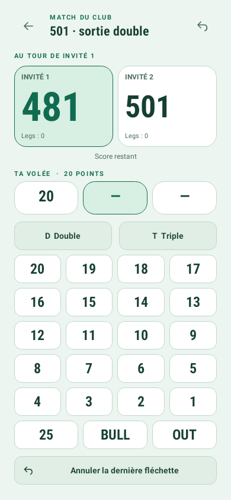
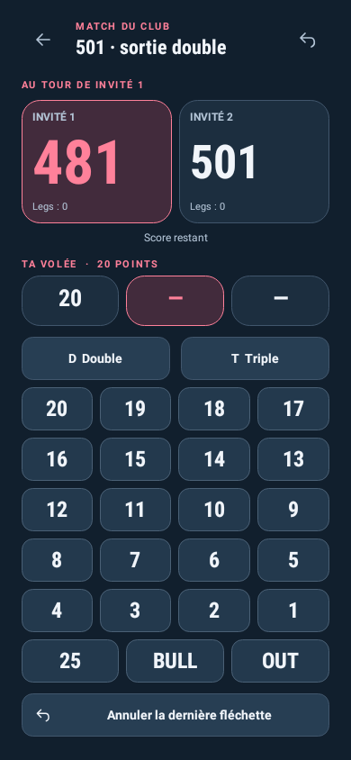
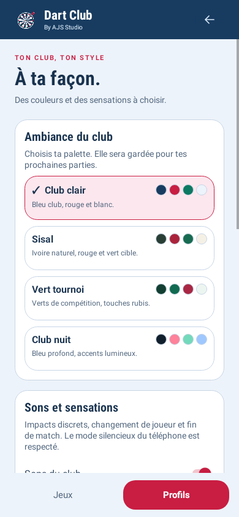
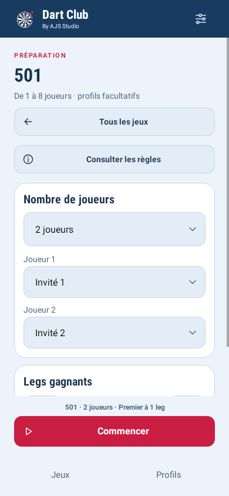
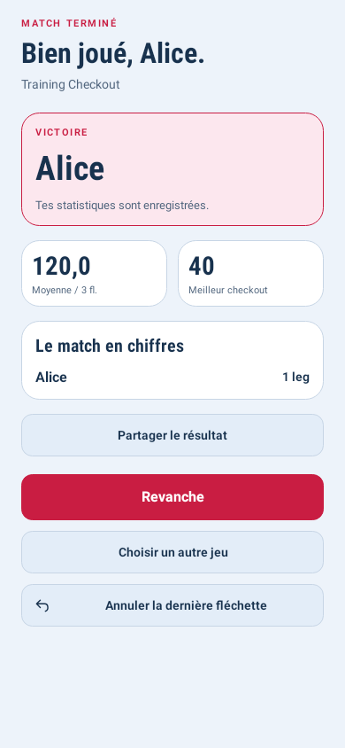

# Dart Club By AJS Studio

Application Android de fléchettes : **15 jeux**, **1 à 8 joueurs**, profils locaux et statistiques de précision.

## Télécharger l’application

**[Télécharger l’APK V0.13 — quatre thèmes et nouvelles sensations de jeu](https://github.com/thomassauve2935-maker/dart-club-by-ajs-studio/raw/refs/tags/v0.13.0-test/apks/v0.13.0-test/Dart_Club_By_AJS_Studio_V0_13_Test.apk)**

[Voir toutes les versions](https://github.com/thomassauve2935-maker/dart-club-by-ajs-studio/releases)

- Android **8.0 ou plus récent**.
- Version de test **0.13.0-club-test**, code **14**, publiée le **16 novembre 2026**.
- **Aucune publicité active**, aucun bandeau vide.
- Chaque Release propose un lien direct vers son APK, conservée dans `apks/`.

## Installer ou mettre à jour

1. Télécharger le fichier `.apk` sur le téléphone Android.
2. L’ouvrir et autoriser l’installation depuis le navigateur ou le gestionnaire de fichiers si Android le demande.
3. Installer la mise à jour puis ouvrir **Dart Club By AJS Studio**.

La signature de test est identique aux V0.9 à V0.12 publiées ici. Installer la V0.13 par-dessus l’application existante, sans la désinstaller, pour conserver les profils et statistiques.

## Quatre ambiances pour le club

Dans **Réglages → Ambiance du club**, choisir une palette mémorisée. **Club clair** reste le thème initial.

| Club clair | Sisal | Vert tournoi | Club nuit |
| :---: | :---: | :---: | :---: |
|  |  |  |  |

Rendus des vues Android avec Robolectric, sans capture sur téléphone physique.

## Nouveautés V0.13

- Boutons et cartes réagissant à l’appui, transitions courtes, score et joueur actif mis en valeur.
- Sons discrets, volume et vibrations réglables. Les sons respectent le mode silencieux/vibreur du téléphone. Option de réduction des animations.
- Retour visuel et sonore pour le changement de joueur, le bust, une volée de 180 et la fin du match. La célébration finale ne se répète pas à chaque ouverture du résultat.
- Reprise avec joueurs, scores et tour actif ; lancement rapide de la dernière configuration.
- Résumé du format visible au-dessus de **Commencer**, y compris sur petit écran.
- Carte du résultat à partager via Android, pour 1 à 8 joueurs.
- Export/import personnel des profils, statistiques, partie en cours et réglages, avec validation du fichier avant confirmation de restauration.

| Réglages | Préparation | Résultat |
| :---: | :---: | :---: |
|  |  |  |

## Le jeu

- 501 en vedette et quatorze autres jeux dans le catalogue.
- Invités sans compte ou profils enregistrés localement.
- Statistiques séparant simples, doubles, triples, 25 et bull.
- Sauvegarde du résultat, annulation, revanche et renommage des profils.
- Grandes commandes et match en deux colonnes sur tablette.
- Logo de cible traditionnelle et fléchette ; icônes couleur et monochrome.

[Logo PNG](assets/logo.png) · [Logo SVG](assets/logo.svg)

Les futurs emplacements publicitaires restent préparés et désactivés : un bandeau adaptatif et une occasion d’interstitiel à la fin de chaque match sauvegardé, jamais entre les legs. Leur activation nécessitera une configuration AdMob réelle et explicite.

**Vérifications V0.13 :** 39 tests automatisés réussis, Android Lint sans erreur ni avertissement, 60 associations de couleurs de texte vérifiées à au moins 4,5:1, manifeste sans initialisation automatique AdMob et signature APK vérifiée. L’essai de cette version sur téléphone physique, notamment des sons et vibrations, reste à effectuer.

Les empreintes SHA-256 sont dans `SHA256SUMS.txt` et dans chaque dossier de version.

## Contenu de ce dépôt

Ce dépôt est dédié aux APK, aperçus et notes de version. Les sources Android et les clés restent hors de ce dépôt public.
