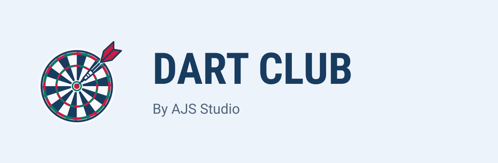
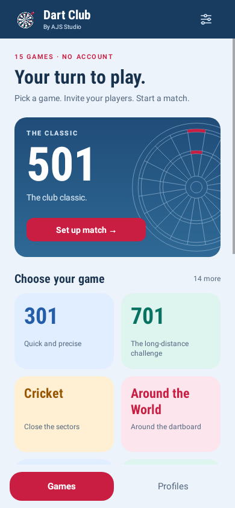
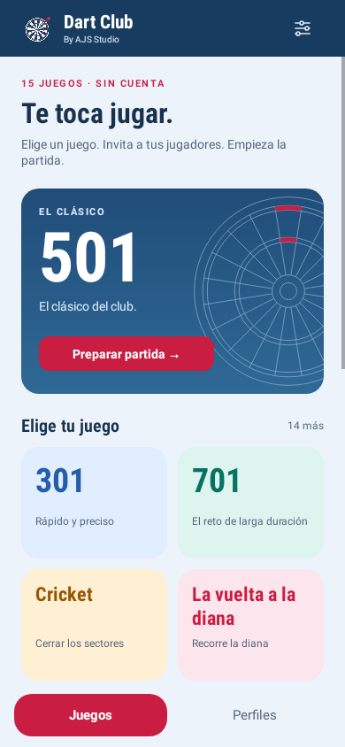
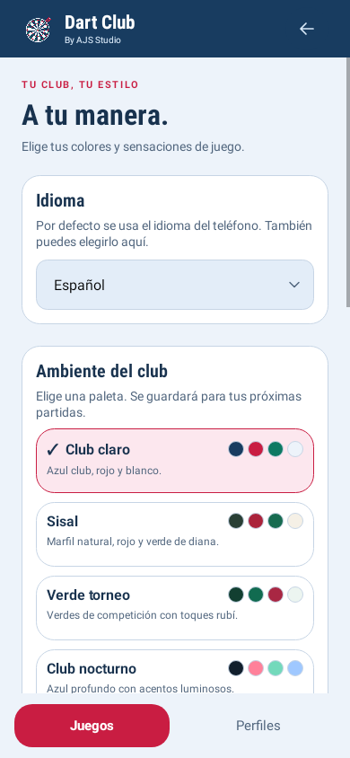
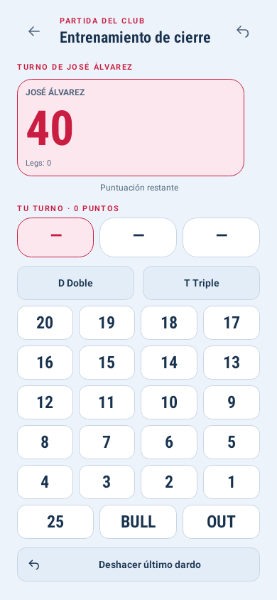
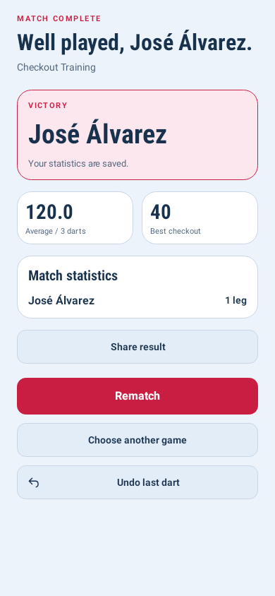
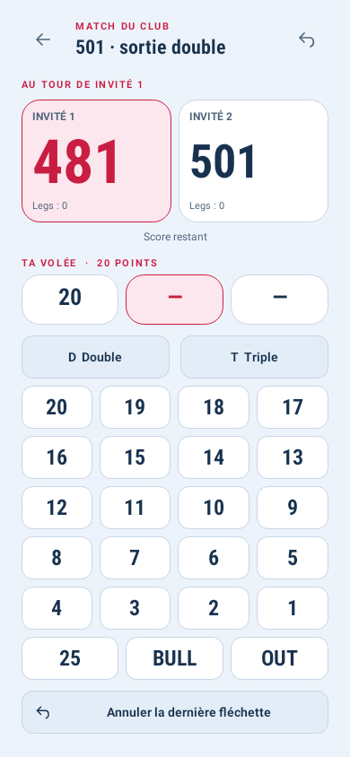
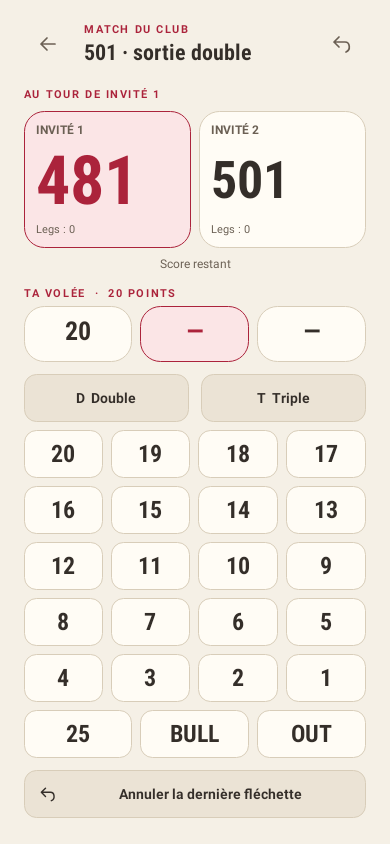

# Dart Club By AJS Studio

Application Android de fléchettes : **15 jeux**, **1 à 8 joueurs**, profils locaux et statistiques de précision.

## Télécharger l’application

**[Télécharger l’APK V0.14 — Français, English, Español](https://github.com/thomassauve2935-maker/dart-club-by-ajs-studio/raw/refs/tags/v0.14.0-test/apks/v0.14.0-test/Dart_Club_By_AJS_Studio_V0_14_Test.apk)**

[Voir toutes les versions](https://github.com/thomassauve2935-maker/dart-club-by-ajs-studio/releases)

- Android **8.0 ou plus récent**.
- Version de test **0.14.0-languages-test**, code **15**, publiée le **16 novembre 2026**.
- **Aucune publicité active**, aucun bandeau vide.
- Chaque Release propose un lien direct vers son APK, conservée dans `apks/`.

## Installer ou mettre à jour

1. Télécharger le fichier `.apk` sur le téléphone Android.
2. L’ouvrir et autoriser l’installation depuis le navigateur ou le gestionnaire de fichiers si Android le demande.
3. Installer la mise à jour puis ouvrir **Dart Club By AJS Studio**.

La signature de test est identique aux V0.9 à V0.13 publiées ici. Installer la V0.14 par-dessus l’application existante, **sans la désinstaller**, pour conserver les profils et statistiques.

## Trois langues

Dans **Réglages → Langue**, choisir **Langue du téléphone**, **Français**, **English** ou **Español**.

Le choix automatique utilise la première langue prise en charge dans les préférences du téléphone, avec repli en français. Le choix manuel est mémorisé.

- Menus, règles des quinze jeux, profils, statistiques, dialogues, messages de partie et partage du résultat traduits.
- Pluriels et moyennes adaptés à la langue.
- Noms saisis par les joueurs conservés. Les invités automatiques sont affichés dans la langue choisie.
- Partie en cours et historique des lancers conservés lors du changement de langue.
- La langue est incluse dans les sauvegardes personnelles ; les fichiers V0.13 restent compatibles.

| Français | English | Español |
| :---: | :---: | :---: |
|  |  |  |

| Choix de langue | Partie en espagnol | Résultat en anglais |
| :---: | :---: | :---: |
|  |  |  |

Rendus des vues Android avec Robolectric, sans capture sur téléphone physique.

## Quatre ambiances pour le club

Dans **Réglages → Ambiance du club**, choisir une palette mémorisée. **Club clair** reste le thème initial.

| Club clair | Sisal | Vert tournoi | Club nuit |
| :---: | :---: | :---: | :---: |
|  |  |  |  |

## Le jeu

- 501 en vedette et quatorze autres jeux dans le catalogue.
- Invités sans compte ou profils enregistrés localement.
- Statistiques séparant simples, doubles, triples, 25 et bull.
- Sauvegarde du résultat, annulation, revanche et renommage des profils.
- Reprise avec scores, lancement rapide des derniers réglages et résumé visible avant de commencer.
- Sons discrets, volume et vibrations réglables ; mode silencieux respecté et option de réduction des animations.
- Carte PNG du résultat à partager via Android pour 1 à 8 joueurs.
- Export/import personnel des profils, statistiques, réglages et partie en cours.
- Grandes commandes, petit écran et match en deux colonnes sur tablette.
- Logo de cible traditionnelle et fléchette ; icônes couleur et monochrome.

[Logo PNG](assets/logo.png) · [Logo SVG](assets/logo.svg)

Les futurs emplacements publicitaires restent préparés et désactivés : un bandeau adaptatif et une occasion d’interstitiel à la fin de chaque match sauvegardé, jamais entre les legs. Leur activation nécessitera une configuration AdMob réelle et explicite.

**Vérifications V0.14 :** 49 tests automatisés réussis, 278 entrées complètes dans les trois langues, Android Lint sans erreur ni avertissement, manifeste sans initialisation automatique AdMob et signature APK vérifiée. L’essai de cette version sur téléphone physique reste à effectuer.

Les empreintes SHA-256 sont dans `SHA256SUMS.txt` et dans chaque dossier de version.

## Contenu de ce dépôt

Ce dépôt est dédié aux APK, aperçus et notes de version. Les sources Android et les clés restent hors de ce dépôt public.
