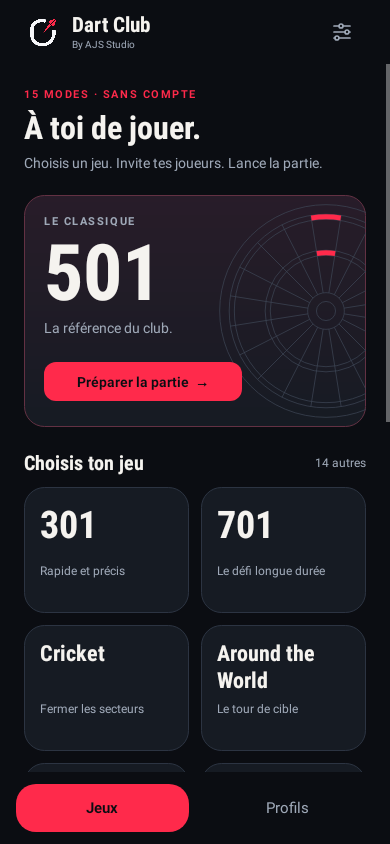
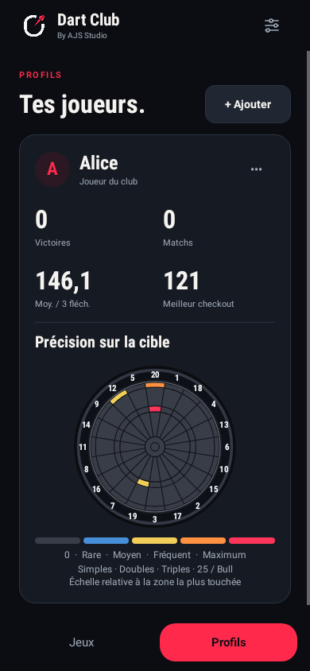
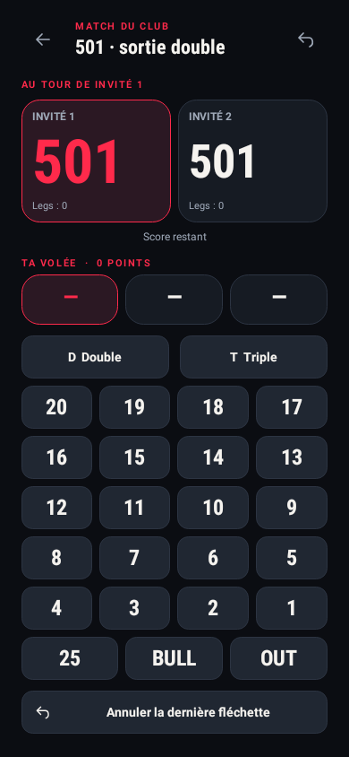

# Dart Club By AJS Studio

Application Android de fléchettes : **15 jeux**, **1 à 8 joueurs**, profils locaux et statistiques de précision.

## Télécharger l’application

**[Télécharger l’APK de test V0.10](https://github.com/thomassauve2935-maker/dart-club-by-ajs-studio/raw/refs/tags/v0.10.0-test/apks/v0.10.0-test/Dart_Club_By_AJS_Studio_V0_10_Test.apk)**

[Voir toutes les versions et leurs APK](https://github.com/thomassauve2935-maker/dart-club-by-ajs-studio/releases)

- Android **8.0 ou plus récent**.
- Version : **0.10.0-club-test**, code 11.
- Version de test publiée le **14 novembre 2026**.
- Chaque **Release** propose un lien direct vers son APK. Les fichiers sont conservés dans le dossier `apks/`.

## Installer une APK

1. Télécharger le fichier `.apk` depuis le téléphone Android.
2. Ouvrir le fichier et autoriser l’installation depuis le navigateur ou le gestionnaire de fichiers si Android le demande.
3. Ouvrir **Dart Club By AJS Studio**.

La V0.10 utilise la même signature de test que la V0.9 publiée ici : elle peut être installée par-dessus pour conserver les profils et les statistiques locales.

## Aperçu V0.10

| Catalogue | Profil et précision | Match |
| :---: | :---: | :---: |
|  |  |  |

Rendus des vues Android avec Robolectric ; données de démonstration dans les aperçus.

## Dans cette version

- 501 mis en vedette avec cible vectorielle, et quatorze autres jeux accessibles dans le catalogue.
- Palette anthracite, navigation rouge et score actif plus visible.
- Profils aérés, initiales et menu de gestion à côté du nom.
- Invités sans compte ou profils enregistrés sur l’appareil.
- Statistiques séparant simples, doubles, triples, 25 et bull.
- Enregistrement du résultat, annulation, revanche et reprise des parties.
- Renommage des joueurs avec conservation des statistiques.
- Grandes commandes, préparation adaptée aux petits écrans et affichage du match sur tablette.

**Vérifications V0.10 :** 20 tests automatisés réussis, 120 parties terminées puis rejouées, contrôle Android Lint sans erreur ni avertissement, signature de l’APK vérifiée. L’essai sur téléphone physique reste à effectuer.

L’empreinte SHA-256 est fournie dans `SHA256SUMS.txt` et dans la Release correspondante.

## Contenu de ce dépôt

Ce dépôt est dédié à la distribution des APK et aux notes de version. Les sources de l’application sont conservées hors de ce dépôt public.
