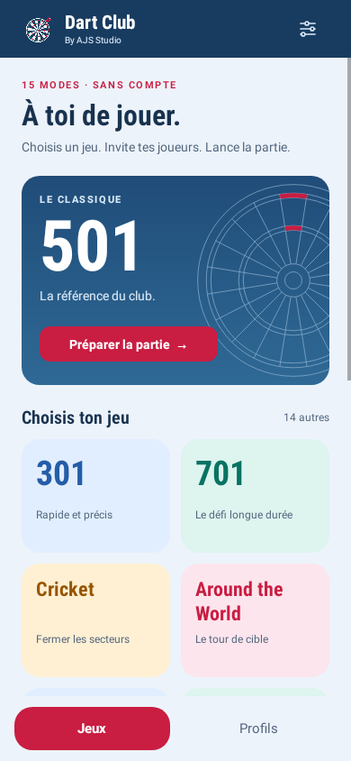
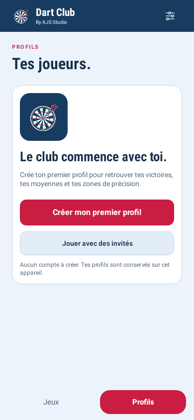

# Dart Club By AJS Studio

Application Android de fléchettes : **15 jeux**, **1 à 8 joueurs**, profils locaux et statistiques de précision.

## Télécharger l’application

**[Télécharger l’APK V0.12 — nouveau logo, sans publicité](https://github.com/thomassauve2935-maker/dart-club-by-ajs-studio/raw/refs/tags/v0.12.0-test/apks/v0.12.0-test/Dart_Club_By_AJS_Studio_V0_12_Test.apk)**

[Voir toutes les versions](https://github.com/thomassauve2935-maker/dart-club-by-ajs-studio/releases)

- Android **8.0 ou plus récent**.
- Version de test **0.12.0-club-test**, code **13**, publiée le **14 novembre 2026**.
- **Aucune publicité active**, ni de démonstration ni commerciale. Aucun bandeau vide ne réserve de place.
- Chaque Release propose un lien direct vers son APK, conservée dans `apks/`.

## Installer ou mettre à jour

1. Télécharger le fichier `.apk` sur le téléphone Android.
2. L’ouvrir et autoriser l’installation depuis le navigateur ou le gestionnaire de fichiers si Android le demande.
3. Installer la mise à jour puis ouvrir **Dart Club By AJS Studio**.

La signature de test est identique à celle de la V0.11 publiée ici : installer la V0.12 par-dessus pour conserver les profils et statistiques locaux, sans désinstaller la V0.11.

## Nouveau logo

Une cible traditionnelle, ses anneaux doubles/triples et une fléchette dans le centre. Le symbole est utilisé dans l’application et son icône Android ; une variante monochrome accompagne les icônes thématiques.

[Logo PNG](assets/logo.png) · [Logo SVG](assets/logo.svg)

| Catalogue | Profil sans données | Icônes Android |
| :---: | :---: | :---: |
|  |  |   |

Rendus des vues Android avec Robolectric, sans capture sur téléphone physique.

## Dans cette version

- Nouveau logo de cible et fléchette, nom Dart Club By AJS Studio conservé.
- Fond clair bleuté, cartes blanches et accents bleu, menthe, ambre, violet et rouge.
- 501 en vedette et quatorze autres jeux accessibles dans le même catalogue.
- Invités sans compte ou profils enregistrés localement.
- Statistiques séparant simples, doubles, triples, 25 et bull.
- Résultat sauvegardé, annulation, revanche, reprise et renommage des profils.
- Grandes commandes, préparation compacte et match en deux colonnes sur tablette.

Les futurs emplacements publicitaires sont préparés mais désactivés : un bandeau adaptatif et une occasion d’interstitiel à la fin de chaque match sauvegardé, jamais entre les legs. Une annulation/revalidation ne crée pas de doublon. Leur activation nécessitera une configuration AdMob réelle et explicite.

**Vérifications V0.12 :** 22 tests automatisés réussis, rapport Android Lint sans erreur ni avertissement, manifeste sans initialisation automatique AdMob et signature APK vérifiée. L’essai de la V0.12 sur téléphone physique reste à effectuer.

Les empreintes SHA-256 sont dans `SHA256SUMS.txt` et dans chaque dossier de version.

## Contenu de ce dépôt

Ce dépôt est dédié aux APK, aperçus et notes de version. Les sources Android et les clés restent hors de ce dépôt public.
